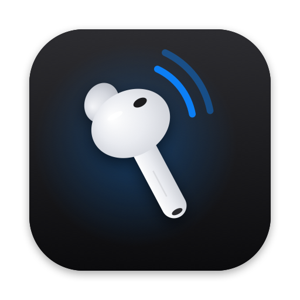

<p align="center">
  
</p>

<h1 align="center">AirPodsCursor</h1>

<p align="center">
  Your AirPods are now a mouse.<br>
  Point with your head. Click by resting. Read without lifting a finger.
</p>

<p align="center">
  <a href="https://github.com/gautamproduct/airpodscursor/releases/latest/download/AirPodsCursor.zip"><b>Download for Mac</b></a>
  &nbsp;·&nbsp;
  macOS 15 or later
  &nbsp;·&nbsp;
  Free and open source
</p>

<p align="center">
  <a href="https://github.com/gautamproduct/airpodscursor/actions/workflows/ci.yml"></a>
  <a href="https://github.com/gautamproduct/airpodscursor/releases/latest"></a>
  
</p>

---

### Point
Turn your head and the pointer follows, smoothly and precisely, across every display. There's nothing to calibrate.

### Click
Rest on a button, link or tab. A ring fills, then it clicks. Resting on text never clicks.

### Read
Reading an article? Rest near the bottom of the screen and the page scrolls down. Near the top, it scrolls up. The closer to the edge, the faster it goes.

### Turn on or off
Shake your head. A sound tells you which way it went.

### Private
No camera. No network. No analytics. Motion data never leaves your Mac.

---

## Get started

1. [Download AirPodsCursor](https://github.com/gautamproduct/airpodscursor/releases/latest/download/AirPodsCursor.zip), unzip it, and move it to Applications.
2. Open it. If macOS can't verify the developer, go to **System Settings › Privacy & Security** and click **Open Anyway**.
3. Allow Accessibility and Motion, then put your AirPods in. That's it.

**Works with** AirPods Pro, AirPods Max, AirPods (3rd generation and later) and Beats Fit Pro.

## Everything it does

| You | AirPodsCursor |
|---|---|
| Turn your head | Moves the pointer |
| Rest on a button | Clicks |
| Rest near the bottom or top | Scrolls the page |
| Shake | Turns head tracking on or off |
| Nod | Clicks |
| Press the stem once, twice, three times | Click, right-click, scroll mode |
| Tilt left or right | Off by default. Assign Back, Forward, Mission Control and more |

Keyboard: **⌃⌥T** on or off · **⌃⌥S** scroll mode · **⌃⌥C** center pointer · **⌃⌥D** drag lock.

Everything can be changed in **Settings**, from the menu bar.

## Help

**The pointer doesn't move.** AirPods only send head movement to the device they're playing on. Choose them in **Control Center › Sound**. AirPodsCursor does this for you when it can.

**It stopped working after an update.** In **System Settings › Privacy & Security › Accessibility**, turn AirPodsCursor off and on again.

**Something else.** Open **Settings › General › Diagnostics**. It shows which step is failing, and **Copy Diagnostics** gives you a report to attach to an issue.

**Stem presses play my music instead.** Another app may be playing. Head gestures always work.

**My keyboard's play/pause key clicks.** While head tracking is on, AirPodsCursor answers play/pause the same way it answers a stem press. Shake to turn tracking off, or turn off stem presses in **Settings › Clicking**.

**The pointer drifts in a car, train or while walking.** AirPods feel the vehicle turn as well as your head. Shake to turn tracking off until you're settled.

**Taking out an AirPod clicks.** Removing one sends "pause". Shake to turn tracking off first, or turn off Automatic Ear Detection.

## Build from source

```bash
git clone https://github.com/gautamproduct/airpodscursor.git && cd airpodscursor
make install
```

Requires Xcode 16 or later. `make run` builds and opens without installing, and `make test` runs the tests. See [CONTRIBUTING.md](CONTRIBUTING.md) for a tour of the code.

## Uninstall

Quit AirPodsCursor from the menu bar and delete it from Applications. To remove its settings and permissions too:

```bash
defaults delete io.github.gautamproduct.AirPodsCursor
tccutil reset All io.github.gautamproduct.AirPodsCursor
```

## License

[MIT License](LICENSE).

<sub>AirPods, AirPods Pro, AirPods Max, Beats and macOS are trademarks of Apple Inc., registered in the U.S. and other countries. AirPodsCursor is an independent project and is not affiliated with, sponsored by, or endorsed by Apple Inc. The app icon and 3D earbuds are original artwork.</sub>
